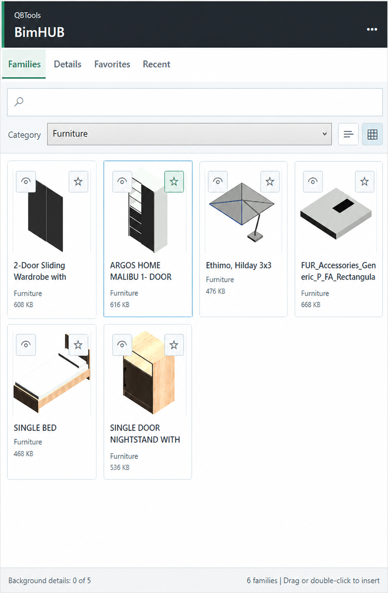
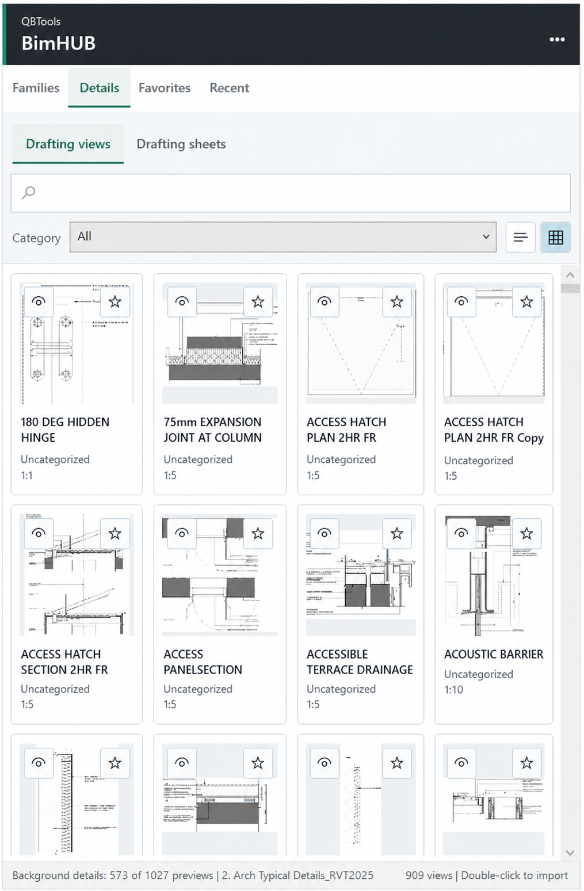

# BimHUB

[](https://github.com/Qubaism/BimHUB/releases/download/v0.1.0-alpha.2/BimHUB-0.1.0-Windows.zip)
[](https://github.com/Qubaism/BimHUB/releases)
[](#revit-compatibility)
[](LICENSE)

BimHUB is a Revit add-in by QBTools. It provides a dockable panel for browsing, searching, previewing, and inserting BIM library content from organized local or shared libraries directly into a Revit project.

<p align="center">
  
</p>

The goal of BimHUB is to make reusable BIM content easier to find, understand, and place in Autodesk Revit. Instead of manually browsing folders or relying on memory, users can search a structured library, preview available content, and insert the right item into the active Revit project with confidence.

## Who This Is For

BimHUB is intended for BIM users and teams who maintain reusable Revit content, including:

- BIM coordinators managing standard families and details
- Architects, engineers, and modelers who regularly reuse project content
- Revit users who want a cleaner way to browse and insert library items
- Small teams building their own BIM standards and content libraries
- Developers learning how to build practical Revit add-ins

## Current Development Scope

The current development build includes:

- A QBTools ribbon panel and BimHUB command
- A dockable Revit library panel
- Multiple configurable Revit family and details folders
- Family search and category filtering
- List and grid layouts with adaptive card sizing
- Family thumbnails, preview windows, metadata, and available types
- Favorites and recently used content
- Family insertion by double-click or drag and drop
- Drafting-view and drafting-sheet browsing
- Drafting-view and sheet previews generated from compatible source projects
- Drafting-view import into the active project
- Drafting-sheet import with its placed drafting views
- Local catalog caching and background preview generation

BimHUB only opens source content that matches the active Revit version. Source families and detail projects are not upgraded or saved by the add-in.

## Revit Compatibility

| Revit version | Build target | Current status |
|---|---|---|
| Revit 2023 | .NET Framework 4.8 | Build, automated tests, and in-Revit testing pass |
| Revit 2024 | .NET Framework 4.8 | Build, automated tests, and in-Revit testing pass |
| Revit 2025 | .NET 8 | Build, automated tests, and in-Revit testing pass |
| Revit 2026 | .NET 8 | Build, automated tests, and in-Revit testing pass |
| Revit 2027 | .NET 8 configuration | Requires the Revit 2027 API before it can be built and verified |

Revit 2023 through Revit 2026 have been validated individually. Compatibility will continue to be checked before each public release.

## Installation

1. Close all Autodesk Revit windows.
2. Use the **Download BimHUB for Windows** button at the top of this page and extract `BimHUB-0.1.0-Windows.zip`.
3. Run `BimHUB-*-Setup.exe` and select the detected Revit versions where BimHUB should be installed.
4. Start Revit and open BimHUB from the **QBTools** ribbon panel.

The installer supports Revit 2023 through Revit 2026, installs only for the current Windows user, and does not require administrator access. It appears as **BimHUB by QBTools** in Windows **Installed apps**.

Alpha installers are not currently code-signed, so Windows may display **Unknown Publisher**. Verify the downloaded installer against the SHA-256 value included with the release before running it.

To repair BimHUB, close Revit and run the same installer again. To upgrade, run the newer installer. To remove BimHUB, use Windows **Installed apps**. Uninstalling the add-in does not remove BimHUB library settings, thumbnails, or catalog caches.

## Product Goals

- Make reusable Revit content fast to find and preview
- Support organized local and shared library locations
- Insert families, drafting views, and drafting sheets safely
- Keep library browsing responsive for larger content collections
- Preserve source files without automatic upgrading or saving
- Keep the public codebase independent of private project knowledge

## Project Status

BimHUB is under active development and available as a public alpha. The current installer supports per-user installation, repair, upgrade, and uninstall for detected Revit 2023 through Revit 2026 installations.

Before a production-ready release, the project will require:

- Continued regression testing across supported Revit versions
- Additional stability and performance testing with larger libraries
- Installer code signing
- Continued testing of installation, repair, upgrade, and uninstall workflows

See the [product roadmap](docs/roadmap.md) for the current development direction.

## How to Use BimHUB

### Family Libraries

1. Open the three-dot menu and select **Library settings**.
2. Under **Revit family folders**, select **Add folder**.
3. Choose one or more local or shared folders containing `.rfa` files.
4. Return to the Families tab and select **Refresh library** when library content changes.

BimHUB scans the selected folders and all their subfolders. Families can then be searched, filtered by category, previewed, marked as favorites, and inserted by double-click or drag and drop.

#### Family Thumbnails

When adding a library for the first time, select **Generate thumbnails** in Library settings to create missing previews.

Thumbnails are stored beside the source families:

```text
Family folder
|-- FamilyName.rfa
`-- _ThumbnailCache
    `-- FamilyName.png
```

The library folder must allow BimHUB to create this cache. Thumbnail generation does not modify or save the source family files.

### Drafting Views and Sheets

Create a Revit source project containing your reusable drafting views. These views can include detail lines, filled or masking regions, detail components, annotations, text, dimensions, and other supported 2D detail content. Sheets containing supported drafting views can also be included.

BimHUB only uses source projects that match the active Revit version. It does not upgrade or save source projects. The recommended workflow is to create the library in the oldest supported Revit version, then save a separate upgraded copy for each required version:

```text
Details Library
|-- Revit 2023
|-- Revit 2024
|-- Revit 2025
`-- Revit 2026
```

To connect the details library:

1. Open **Library settings**.
2. Under **Details folders**, select **Add folder**.
3. Choose the local or shared folder containing the source projects.
4. Select **Refresh details**.

BimHUB scans all subfolders, indexes compatible drafting views and eligible sheets, and caches their previews. Refresh the library after adding or updating source projects. Select the preview icon to inspect an item and double-click its card to import it.

<p align="center">
  
</p>

### Detail Categories

To categorize drafting views, add a text parameter to the views in each source project. For example:

```text
Parameter: Detail Category
Values: Walls, Doors, Waterproofing, Accessibility
```

Enter the exact same parameter name under **Library settings > Drafting-view categories > Category parameter name**, then refresh the details library.

Views without a value appear as **Uncategorized**. Sheet categories are derived from the category values of their placed drafting views.

## License

This project is licensed under the GNU General Public License v3.0. See the [LICENSE](LICENSE) file for details.
